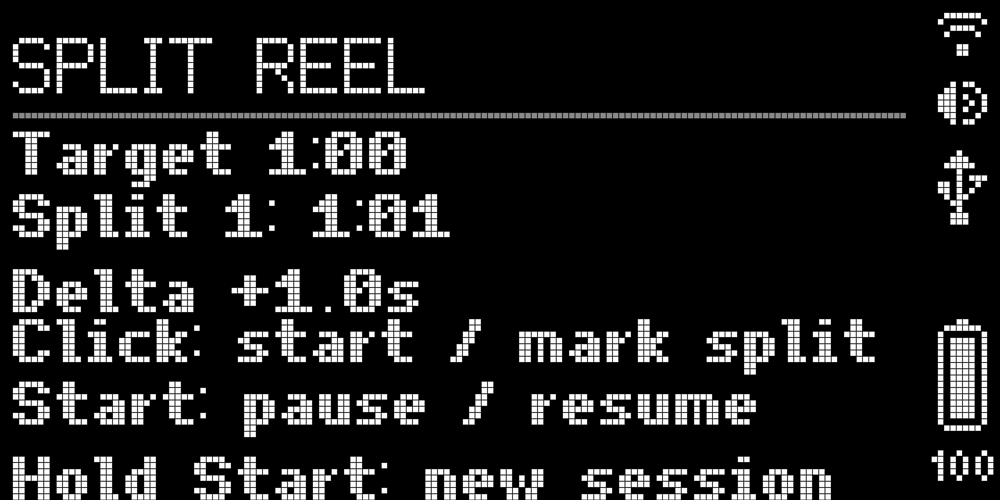
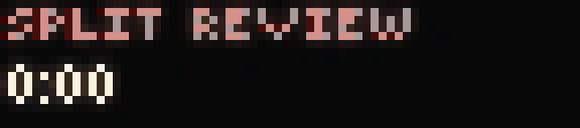
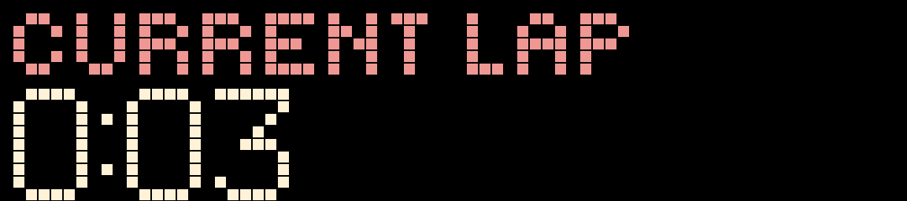

# Split Reel

Record lap splits with one button and compare each repetition against your target.

Give the runner one repeatable action at the finish line. Each click records the lap just completed and begins the next, leaving both the elapsed split and the difference from target available for review.

## Screen transitions

Capture a split, then browse the recorded repetition during the break.


<details>

<summary>Watch the rear display</summary>



</details>

## Time a repetition

1. Before the first lap, turn the wheel to set the target in five-second steps. The rear screen shows the target throughout a session.
2. Click at the start line. Click again on the next crossing to record the first split and immediately start timing the next lap.
3. The recording begins with an earlier split already on the device. Watch the front move from **Split review** to **Current lap**.



## Review a split during a break

1. Press **Start** to pause the current lap. Turn the wheel to select a recorded split; the rear shows its number and signed difference from target.
2. Press **Start** again to resume the paused lap with the accumulated time. Use a short wheel click at the next actual line crossing.
3. Hold **Start** when you are ready to clear the splits and start a new session.



## Example from the emulator

A 65-second repetition against a 60-second target is five seconds over. The front shows the selected split and the rear supplies the delta. Up to 20 splits remain in the review list. The fast button presses in the recording demonstrate transitions rather than running times. Interactive device controls and persistent local state on BUSY Bar firmware.

## Run in the emulator

Open BUSY Bar Emulator. From this repository, run:

```sh
~/.busy-emulator/bin/busy-emulator dev --once
```

Press **Back** to exit.

The GIFs are excerpts from the emulator recording. Each LED occupies a 16 × 16 cell with a black border. The end frames pause for reading.

[Full recording](media/controls.mp4) · [Rear display](screenshots/back-1.png) · [Firmware test](EMULATOR-QA.md) · [MIT license](LICENSE)
